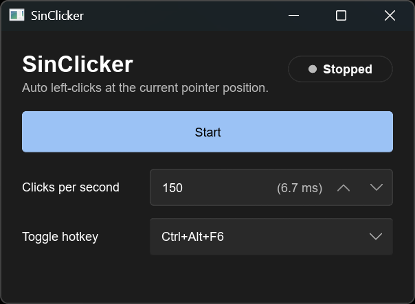

# SinClicker

A small Windows-only autoclicker. It sends left mouse button clicks at
the current pointer position at an adjustable rate (1–500 clicks per
second). Clicking is started and stopped from the window, and a global
hotkey (default Ctrl+Alt+F6) toggles clicking from anywhere. To change the
hotkey, click the hotkey field and press a new combination (Esc cancels);
keys other than F1–F24 need Ctrl or Alt. The window
also shows the target interval between clicks (1000/CPS milliseconds)
beside the click-rate control; it is the nominal target, not a
measurement of actual click timing. Clicks are skipped while the pointer
is over SinClicker's own window, so the app never clicks its own controls
(move the pointer to the target after pressing Start). The
chosen hotkey and click rate are saved and restored across launches. The
app does not require administrator privileges; note that Windows may block
simulated input from reaching higher-integrity applications, and whether
the full 500 clicks per second actually reach the target depends on
Windows scheduling and the target's own input handling.

## Screenshot

## Tech

- Language: Rust
- UI framework: Slint
- Windows APIs (`SendInput`, `RegisterHotKey`) via the `windows` crate

Build and run (Windows):

    cargo run --release

## AI assistance

Development of this project was assisted by Qwen 3.8 27B, a large
language model, running locally. This is a note of AI assistance during
development; the model is not the project's author.

## License

Licensed under the GNU General Public License v3.0 or later
(GPL-3.0-or-later). See [LICENSE](LICENSE) for the full license text.
